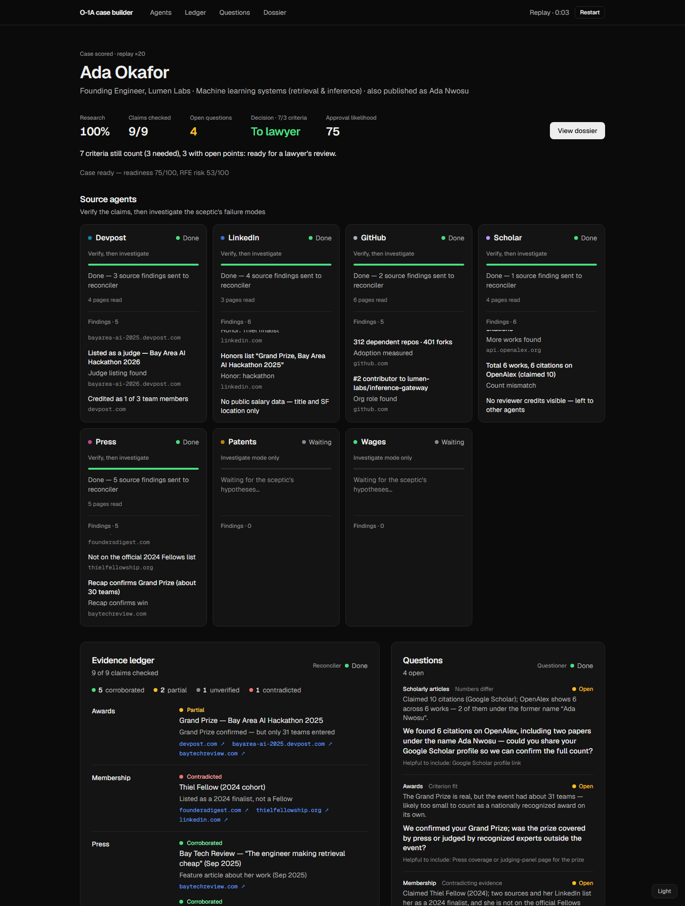
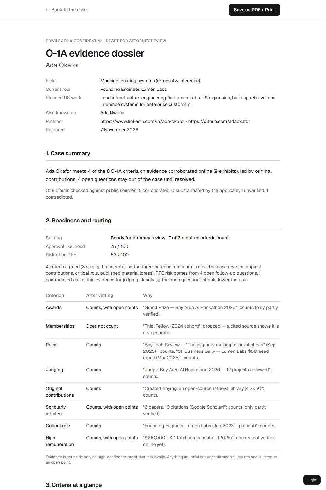

# O-1A Visa Vetting Agent

[](https://github.com/avi-shah1/o1-visa-vetting-agent/actions/workflows/ci.yml)

**🥉 Third Place | [Anything Applied Agentic Hackathon](https://luma.com/gap48i1m)** · San Francisco · 7 November 2026

**🎥 [Watch the hackathon demo](https://www.loom.com/share/c5d85f5988e8424caace7a379dfa6ac8)** (the original submission, recorded under a tight deadline, so a little rough)

An experimental multi-agent system that helps immigration teams vet an O-1A visa applicant. The applicant fills in a structured intake form covering the eight O-1A evidentiary criteria. Research agents then cross-check each claim against public sources, flag inconsistencies and gaps, ask targeted follow-up questions, and assemble a source-linked dossier for attorney review.



## What it does

- **Intake:** collects evidence of awards, memberships, press coverage, judging, original contributions, scholarly work, critical roles and remuneration.
- **Parallel research:** separate agents investigate Devpost, LinkedIn, GitHub, OpenAlex and press/web sources, and record the links that support each finding.
- **Evidence ledger:** a reconciler combines the findings and marks each claim corroborated, partially verified, unverified or contradicted.
- **Precedent check (optional):** a Python retrieval pipeline compares the evidence with published US Administrative Appeals Office (AAO) decisions to find the weaknesses that sank similar petitions, then agents try to measure each one. See [`rag/`](rag/README.md).
- **Follow-up:** generates targeted questions for the applicant and processes the replies.
- **Dossier and score:** produces a printable dossier with a routing decision (to an attorney, or needs more evidence) and an approval-likelihood and RFE-risk score. The score is a rule-based heuristic, not a trained model. See [`docs/scoring.md`](docs/scoring.md).



## How it works

```text
Applicant intake
      |
      +--> Devpost agent -----+
      +--> LinkedIn agent ----+
      +--> GitHub agent ------+--> Reconciler --> Evidence ledger
      +--> OpenAlex agent ----+
      +--> Press agent -------+
                                       |
                             Optional AAO RAG checks
                                       |
                          Clarification and follow-up
                                       |
                         Case dossier + heuristic score
```

Agents are orchestrated with [Mastra](https://mastra.ai), and Zod schemas define each hand-off. Progress streams to a live "war room" dashboard. The dossier is built from a deterministic template, not free-form generation.

## Try it without any keys

The repo includes a recorded run for a fictional applicant, so you can see the whole flow without API keys or a database:

```bash
npm install
npm run dev
```

Then open <http://localhost:3000/case/demo?replay=1>. Add `&speed=4` to play it faster. The "View dossier" button opens the printable dossier for the same case.

## Run it for real

Use a Node.js version that Next.js 16 supports.

```bash
npm install
cp .env.example .env.local      # PowerShell: Copy-Item .env.example .env.local
npm run db:push                 # creates the local SQLite database
npm run dev
```

Open <http://localhost:3000> to fill in the intake form.

Live research needs these keys in `.env.local`: `ANTHROPIC_API_KEY`, `EXA_API_KEY`, `APIFY_TOKEN`, `APIFY_LINKEDIN_ACTOR_ID` and `OPENALEX_MAILTO`. [`.env.example`](.env.example) lists these and the optional ones. These calls cost money, so a full run on a real applicant is not free.

To explore without paid calls, `npm run seed:followup` creates a test case with findings and open questions.

The precedent check needs Python and a logged-in Claude Code CLI. Without it, that stage is skipped. Setup is in [`rag/README.md`](rag/README.md).

Checks: `npm run typecheck`, `npm run lint`, `npm run test:investigation` and `npm run build`. CI runs all four.

## Public demo mode

Setting `DEMO_MODE=1` turns the app into a read-only demo. Every page redirects to the recorded replay and `/api/*` returns 403, so a public deployment cannot start agent runs or spend API credits. This is how a hosted copy is meant to be deployed (for example on Vercel, with `DEMO_MODE=1` as an environment variable and no API keys). The logic is in [`src/proxy.ts`](src/proxy.ts).

## Tech stack

| Layer | Technologies |
| --- | --- |
| Frontend | Next.js 16, React, TypeScript, Tailwind CSS |
| Agents and orchestration | Mastra, Anthropic models, Zod |
| Research integrations | Exa, Apify, Devpost, GitHub REST API, OpenAlex |
| Legal precedent analysis | Python, retrieval over published AAO decisions |
| Data | SQLite/libSQL, Drizzle ORM |

## Repository structure

| Path | Purpose |
| --- | --- |
| `src/app/apply/` | Multi-step application form |
| `src/mastra/agents/` | Research, reconciliation and follow-up agents |
| `src/mastra/workflows/` | Vetting and investigation orchestration |
| `src/mastra/tools/` | Research integrations |
| `src/components/war-room/` | Dashboard, evidence ledger and agent activity |
| `src/lib/case-template.ts` | Dossier builder |
| `src/scorer/index.ts` | Heuristic scoring ([how it works](docs/scoring.md)) |
| `rag/` | AAO precedent retrieval ([details](rag/README.md)) |
| `replays/demo.json` | Recorded run for a fictional applicant |

## Limitations

This is a hackathon project, not legal advice and not a prediction of what USCIS will decide. Source agents can match the wrong person or miss evidence, the scorer is a set of hand-set rules, and the precedent corpus is a small, denial-heavy sample of AAO decisions. Everything it produces is meant to be reviewed by an attorney.
